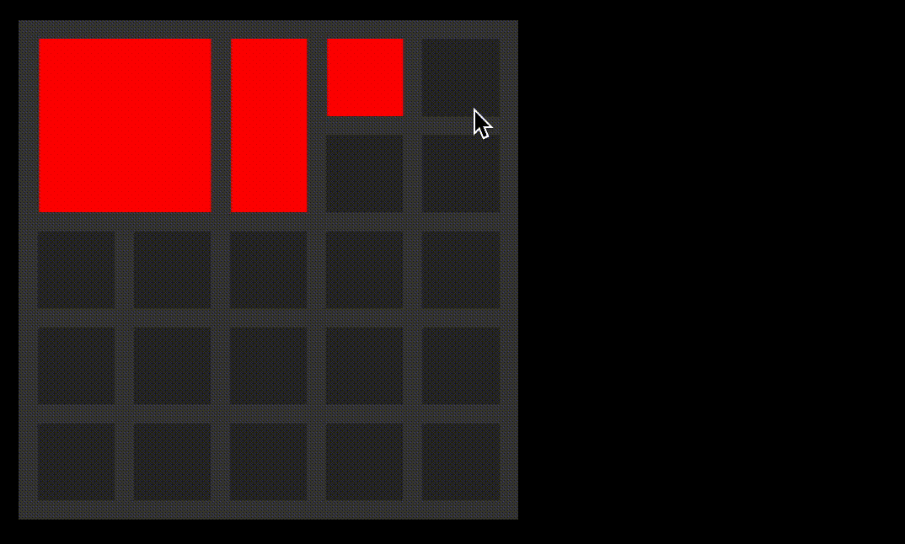

# unity-grid-inventory-system
A grid based inventory system that support different sizes of items in Unity with UI toolkit.

## Usage
`Classes.cs` stores all the customized VisualElement classes.

`InventoryUiManager.cs` is the manager that handles UI displaying and item dragging.

Set `gridSize` and `margin` in ItemElement class which are the pixel size and margin of your grids.

Assign `List<YourItemDataClass> inventory` to `itemDatas` in `GridContainer` class.

You may need to modify codes related to the `UIManager` class as it is from my project, not part of this demo.
